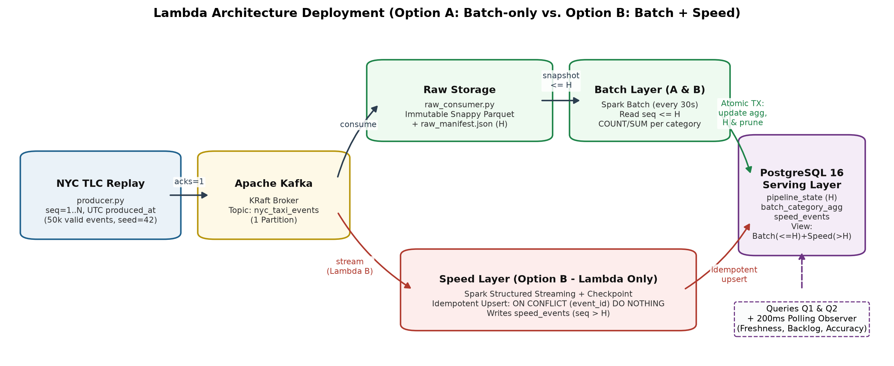
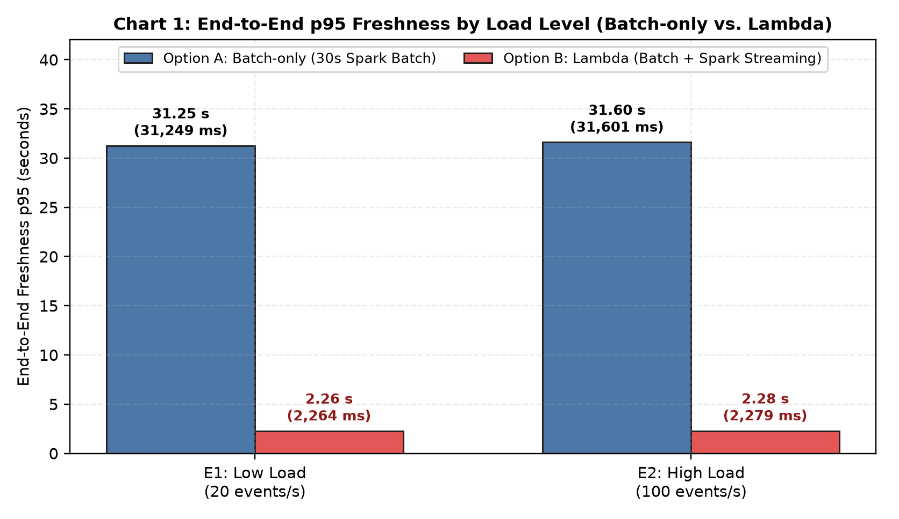
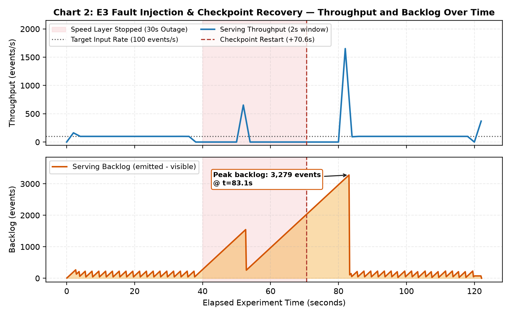
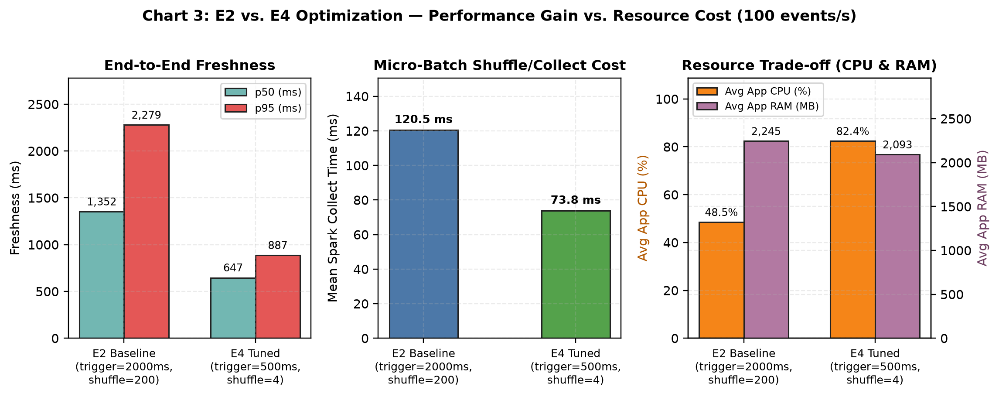
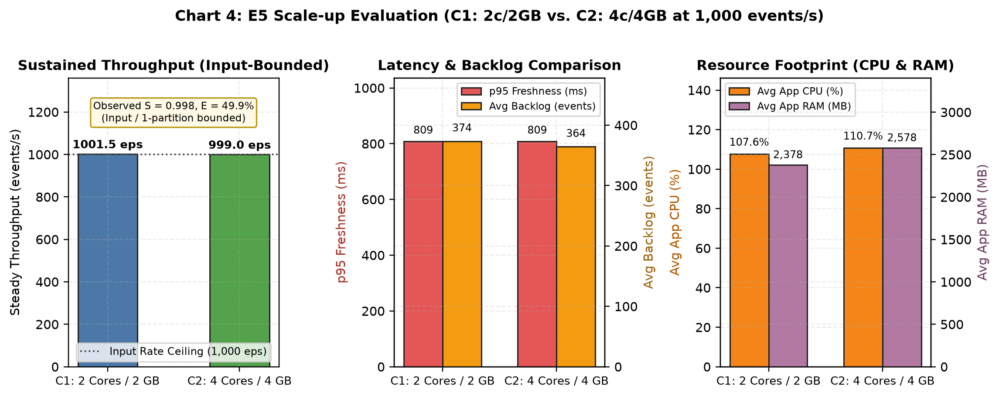

# Báo cáo Assignment 4: Thiết kế và Đánh giá Data Pipeline theo Kiến trúc Lambda

* Mã HP: IT4931 - BigData Storage and Processing
* Họ và tên: Nguyễn Đăng Long
* MSSV: 202400057

## 1. Dữ liệu, Chuẩn hóa và Môi trường Thực nghiệm

### 1.1 Nguồn dữ liệu và quy tắc chuẩn hóa
Thí nghiệm sử dụng tập dữ liệu thực tế NYC TLC Yellow Taxi Trip Records (01/2024), tải ngày 22/11/2026 từ CloudFront CDN chính thức của NYC TLC (`yellow_tripdata_2024-01.parquet`, 49,961,641 bytes, SHA-256: `c4d59da7bbc8abaeeeb1727947ee93d9891a71acb42854bd80db1571b2030510`).

Pipeline chuẩn hóa (`src/prepare_data.py`) lọc dữ liệu bất thường theo 4 quy tắc:

* Loại các dòng có giá trị NULL tại `tpep_pickup_datetime`, `PULocationID` hoặc `total_amount` (loại 0 dòng).
* Giữ mã vùng đón khách hợp lệ `1 <= PULocationID <= 265` (loại 0 dòng).
* Giữ giao dịch hợp lệ trong khoảng `0 < total_amount <= 500.0` USD để loại hoàn tiền/giá trị âm và nhiễu cực trị (loại 35,982 dòng).
* Giữ mốc thời gian đón khách thuộc tháng 01/2024 UTC (loại 17 dòng).

Từ 2,964,624 dòng đầu vào, hệ thống thu được 2,928,625 dòng hợp lệ (loại 35,999 dòng). Sau đó, script lấy mẫu tất định 50,000 bản ghi (`seed = 42`, gồm 205 category `zone_001`..`zone_265`) để chạy benchmark, đồng thời xuất mẫu 1,500 sự kiện (`data/sample_events.jsonl`) kèm nhật ký nguồn `data/data_manifest.json`.

| Trường | Định nghĩa trong pipeline |
| :--- | :--- |
| `event_id` | 24 ký tự hex đầu của `SHA-256(tlc202401:orig_idx:event_time:category:amount_cents)` dùng khử trùng lặp |
| `seq` | Thứ tự tăng liên tiếp `1, 2, 3, ...` do producer đơn luồng gán khi phát vào Kafka (1 partition) |
| `event_time` | Thời điểm đón khách gốc (`tpep_pickup_datetime`, định dạng ISO-8601 UTC) |
| `produced_at` | Thời điểm thực tế producer phát sự kiện trong thí nghiệm (UTC), không lấy `event_time` gốc |
| `category` | Mã vùng đón khách chuẩn hóa (`zone_001` .. `zone_265`, 205 nhóm) |
| `amount_cents` | Giá trị nguyên `round(total_amount * 100)` dùng để tính `SUM` chính xác |

### 1.2 Cấu hình phần cứng và phiên bản công cụ
* **Phần cứng máy chủ**: CPU AMD Ryzen 7 7735HS (8 Cores / 16 Threads), RAM vật lý 15.24 GB (cấp 7.4 GiB cho WSL2 Ubuntu), chạy tuần tự từng thí nghiệm trên một máy.
* **Phiên bản phần mềm**: Docker Engine v29.8.0 (Compose v5.5.1), Apache Kafka (`apache/kafka:latest`, KRaft 1 broker, topic `nyc_taxi_events` có 1 partition), PostgreSQL 16-alpine, PySpark 4.3.0 (Local mode, OpenJDK 17.0.20.1, `spark-sql-kafka-0-10_2.13:4.3.0`, `postgresql:42.7.4`) và Python 3.14.4.
* **Giới hạn tài nguyên Spark**: Cấu hình mặc định (E1–E4 và C1) là `local[2]` với `2g` driver memory; cấu hình scale-up C2 (E5) là `local[4]` với `4g` driver memory.

## 2. Kiến trúc Triển khai và Cơ chế Hợp nhất Đúng đắn


*Hình 1: Kiến trúc triển khai Option A (Batch-only) và Option B (Lambda) với cơ chế hợp nhất nhất quán trên PostgreSQL.*

* **Ingestion & Raw Storage**: `producer.py` phát sự kiện vào Kafka (1 partition, `acks=1`) và lưu nhật ký sự kiện đã phát để đối chiếu ground truth. `raw_consumer.py` đọc Kafka và ghi các file Snappy Parquet bất biến qua cơ chế ghi tạm `.tmp` rồi đổi tên nguyên tử `os.replace`. File `raw_manifest.json` chỉ nâng watermark liên tục `H` khi toàn bộ `seq <= H` đã an toàn trên đĩa.
* **Batch Layer (Option A & B)**: `batch_layer.py` chạy định kỳ 30 giây, đọc các file Parquet bất biến với `seq <= H`. Sau khi khử trùng theo `event_id`, job tính `COUNT(*)` và `SUM(amount_cents)` theo `category`.
* **Speed Layer (Option B)**: `speed_layer.py` (Spark Structured Streaming có checkpoint) đọc liên tục từ Kafka, khử trùng trong micro-batch và ghi idempotent vào `speed_events` bằng `INSERT ... ON CONFLICT (event_id) DO NOTHING`.
* **Serving Layer & Tính nhất quán**: PostgreSQL lưu `pipeline_state` (mốc `batch_watermark_seq = H`), `batch_category_agg`, `speed_events` và view `serving_category_agg` theo công thức `BatchAgg(seq <= H) + SpeedEvents(seq > H)`. Khi Batch cập nhật mốc `H`, toàn bộ thao tác khóa bảng `pipeline_state`, ghi `batch_category_agg`, tăng `H` và xóa `speed_events WHERE seq <= H` nằm trong một transaction duy nhất (`COMMIT`). Nhờ MVCC của PostgreSQL, truy vấn Q1 và Q2 luôn đọc được ảnh chụp nhất quán, không bị thiếu tạm thời hay cộng trùng.

### 2.1 Lược đồ PostgreSQL, truy vấn Q1/Q2 và kiểm chứng thực tế
Lược đồ phục vụ (`sql/schema.sql`) định nghĩa `batch_category_agg` (`seq <= H`), `speed_events` (`event_id PRIMARY KEY`), `pipeline_state` (mốc `H`) và view hợp nhất `serving_category_agg`:

```sql
-- Q1: COUNT and SUM(amount_cents) by category
SELECT category, event_count, total_amount_cents
FROM serving_category_agg ORDER BY total_amount_cents DESC, category ASC;

-- Q2: System-wide total COUNT and SUM(amount_cents)
SELECT COALESCE(SUM(event_count), 0)::BIGINT AS total_count,
       COALESCE(SUM(total_amount_cents), 0)::BIGINT AS total_amount_cents
FROM serving_category_agg;
```

Kiểm tra trực tiếp sau lượt chạy `E5_C2_4c4g_r2` (120,000 sự kiện) qua `src/verify_queries.py` và `psql` ghi nhận: `Watermark H = 110,604` (`batch_runs = 4`, `batch_events = 110,604`), `active_speed_events = 9,396` và `stale_speed_events = 0`. Tổng phục vụ đạt đúng 120,000 sự kiện và 327,941,775 cents (`Diff count = 0`, `Diff sum_cents = 0`, `Category mismatches = 0`), trong đó vùng dẫn đầu là `zone_132` (6,003 chuyến, 47,603,801 cents).

## 3. Phương pháp Thử tải và Định nghĩa Chỉ số

Hai phương án A và B được chạy tuần tự trên cùng tập dữ liệu và cấu hình máy. Giữa mỗi lượt, script chạy `--reset` để tạo lại topic Kafka, `TRUNCATE` các bảng PostgreSQL, xóa thư mục raw Parquet và checkpoint. Với E1, E2, E4 và E5, mỗi cấu hình chạy 2 lượt độc lập; 20 giây đầu được dùng làm warm-up khi tính trung bình các chỉ số ổn định.

* **Freshness đầu-cuối (p50/p95)**: Bộ quan sát độc lập (`monitor.py`) truy vấn PostgreSQL ở mức cô lập `REPEATABLE READ` mỗi 200 ms trên >= 120 sự kiện mẫu mỗi lượt. Phép đo chỉ ghi nhận thời điểm `visible_epoch` khi sự kiện thực sự đã góp mặt trong `serving_category_agg` (qua `seq <= H` hoặc nằm trong `speed_events` với `seq > H`). Các mẫu cuối pha phát của Batch-only chưa xuất hiện trước giây 120 được chờ ở pha drain (tối đa 55s) và ghi nhận riêng (`unseen_during_emission`, `unseen_after_drain = 0`).
* **Throughput, Backlog, SQL/Batch cost & CPU/RAM**: `backlog(t) = emitted_count(t) - visible_count(t)` được đối chiếu theo dấu thời gian thực. Độ trễ Q1/Q2 được đo mỗi 2 giây; CPU% và RSS MB của cây tiến trình ứng dụng (`raw_consumer`, Spark Batch, Spark Speed) được thu thập qua `psutil` mỗi 1 giây.

## 4. Kết quả Thực nghiệm (E1 – E5)

| Thí nghiệm / Cấu hình | Lượt | Input (ev/s) | Steady Thr (ev/s) | Freshness p50 (ms) | Freshness p95 (ms) | Avg / Max Backlog | Avg App CPU (%) | Avg App RAM (MB) | Q1 p95 (ms) | Sai lệch GT |
| :--- | :---: | :---: | :---: | :---: | :---: | :---: | :---: | :---: | :---: | :---: |
| E1 – Batch-only (2c/2g) | 2 | 20.01 | 17.80 | 16,272.8 | 31,249.4 | 374.4 / 668 | 27.5% | 962.2 | 1.00 | 0 / True |
| E1 – Lambda (2c/2g) | 2 | 20.01 | 20.03 | 1,450.0 | 2,264.4 | 25.1 / 51.5 | 42.4% | 2,121.4 | 1.01 | 0 / True |
| E2 – Batch-only (2c/2g) | 2 | 100.01 | 88.67 | 16,798.4 | 31,601.2 | 1,911.4 / 3,341.5 | 29.7% | 997.3 | 1.04 | 0 / True |
| E2 – Lambda Baseline | 2 | 100.01 | 100.15 | 1,352.3 | 2,278.6 | 126.6 / 277.5 | 48.5% | 2,244.5 | 2.27 | 0 / True |
| E3 – Lambda Fault (30s) | 1 | 100.01 | 100.16 | 2,145.5 | 27,754.0 | 729.8 / 3,279 | 79.6% | 1,621.5 | 1.77 | 0 / True |
| E4 – Lambda Tuned | 2 | 100.01 | 100.16 | 646.8 | 886.6 | 47.0 / 288.5 | 82.4% | 2,092.6 | 2.08 | 0 / True |
| E5 – C1 (2c/2g @ 1k ev/s) | 2 | 1,000.00 | 1,001.51 | 444.6 | 809.0 | 373.5 / 2,975.5 | 107.6% | 2,377.8 | 13.66 | 0 / True |
| E5 – C2 (4c/4g @ 1k ev/s) | 2 | 1,000.00 | 999.01 | 467.6 | 809.0 | 364.4 / 3,079 | 110.7% | 2,577.7 | 13.60 | 0 / True |

*Bảng 1: Tổng hợp kết quả trung bình các lượt thực nghiệm E1–E5. Tất cả 15 lượt chạy đạt `count_diff = 0`, `sum_diff_cents = 0` và `category_mismatches = 0` sau khi hoàn tất drain.*


*Hình 2 (Biểu đồ 1): So sánh p95 freshness giữa Batch-only và Lambda theo mức tải E1 (20 ev/s) và E2 (100 ev/s).*


*Hình 3 (Biểu đồ 2): Diễn biến throughput và backlog trong thực nghiệm E3 (dừng Speed Layer 30s tại +40s và khôi phục từ checkpoint).*

* **So sánh E1 & E2 (Batch-only vs. Lambda)**: Ở Batch-only, `freshness p95` đạt 31.25 s (E1) và 31.60 s (E2), đồng thời 38–40/120 mẫu cuối pha phát phải chờ sang chu kỳ drain kế tiếp (`unseen_during_emission = 38–40`). Lambda rút ngắn `p95 freshness` khoảng 13.8 lần xuống còn 2.26 s (E1) và 2.28 s (E2), bám sát tốc độ phát 100.15 ev/s với backlog trung bình chỉ 126.6 sự kiện. Đổi lại, Lambda tiêu tốn RAM ứng dụng gấp 2.20–2.25 lần (2,121–2,245 MB so với 962–997 MB) và CPU gấp 1.54–1.63 lần (42.4–48.5% so với 27.5–29.7%) do duy trì đồng thời hai Spark JVM. Thời gian chạy Batch mỗi 30s ở trạng thái ổn định là 1.49–2.83 s (lượt đầu khởi động JVM 4.24–5.05 s), còn truy vấn Q1/Q2 p95 trên PostgreSQL luôn dưới 2.4 ms.
* **Phân tích E3 (Fault Injection & Checkpoint Recovery)**: Khi dừng `speed_layer` từ +40.0s đến +70.6s, backlog tăng tuyến tính lên 1,550 sự kiện trước khi Batch Layer chạy chu kỳ tại `t ≈ 53s` và kéo backlog tạm giảm về ~260. Điều này chứng minh nhánh Batch vẫn bảo vệ dữ liệu phục vụ ngay cả khi nhánh Speed ngưng hoạt động. Sau đó backlog đạt đỉnh 3,279 sự kiện tại `t = 83.1s` trong lúc Spark JVM khởi động lại từ checkpoint, rồi bứt tốc xử lý 4,298 sự kiện trong micro-batch khôi phục (`throughput > 1,600 ev/s`) để đưa hệ thống về trạng thái cân bằng với 0 bản ghi trùng lặp hoặc thất thoát.

## 5. Phân tích Nút thắt, Cải tiến (E4) và Khả năng Mở rộng (E5)

### 5.1 Phân tích nút thắt từ E1–E3 và kiểm chứng cải tiến E4
* **Bằng chứng nút thắt**: Log `E2_lambda_r1/r2_speed_metrics.csv` (61–62 micro-batches) cho thấy thời gian ghi PostgreSQL bằng `execute_values` chỉ tốn trung bình 17.9–21.9 ms (ngay cả lô khôi phục 4,298 dòng ở E3 cũng chỉ mất 157.3 ms). Ngược lại, `spark_ms` tốn trung bình 120.5 ms (khoảng 85% tổng thời gian micro-batch) và tăng vọt lên 2,059 ms khi khôi phục E3. Nguyên nhân là phép `dropDuplicates(["event_id"])` kích hoạt mặc định `spark.sql.shuffle.partitions = 200`, tạo tới 200 shuffle tasks cho chỉ ~200 dòng/batch trên 2 cores. Bên cạnh đó, `trigger = 2000 ms` tạo sàn trễ hàng đợi 1–2 giây, đẩy `freshness p95` lên 2,278.6 ms.
* **Giả thuyết & Thay đổi (E4)**: Giữ nguyên tài nguyên `2c/2g`, Kafka, PostgreSQL và workload 100 ev/s, chỉ điều chỉnh nhóm cấu hình lập lịch và song song micro-batch của Speed Layer (`spark.sql.shuffle.partitions: 200 -> 4`, `trigger: 2000 ms -> 500 ms`). Kỳ vọng chi phí lập lịch shuffle giảm rõ rệt và `p95 freshness` xuống dưới 1,000 ms.
* **Kết quả E2 vs. E4**: Sau cải tiến (Hình 4), `freshness p95` giảm 61.1% (2,278.6 ms xuống 886.6 ms) và `p50` giảm 52.2% (1,352.3 ms xuống 646.8 ms). Backlog trung bình giảm 62.9% (126.6 xuống 47.0 sự kiện), thời gian Spark mỗi micro-batch giảm 38.8% (120.5 ms xuống 73.8 ms) và RAM giảm nhẹ từ 2,244.5 MB xuống 2,092.6 MB.
* **Đánh đổi & Khuyến nghị**: Tần suất micro-batch tăng 4 lần (2 Hz so với 0.5 Hz) làm CPU trung bình ứng dụng tăng từ 48.5% lên 82.4% (+33.9 điểm %) và số transaction commit vào PostgreSQL tăng 4 lần. Khuyến nghị áp dụng E4 cho các bài toán yêu cầu SLA `< 1 s`, và giữ `trigger = 2000 ms` nếu cần tiết kiệm CPU khi SLA cho phép `2–3 s`.


*Hình 4 (Biểu đồ 3): Hiệu quả cải tiến E4 so với E2 baseline (độ trễ freshness, chi phí shuffle Spark và tài nguyên CPU/RAM).*


*Hình 5 (Biểu đồ 4): Đánh giá Scale-up E5 giữa C1 (2c/2GB) và C2 (4c/4GB) ở mức tải 10× (1,000 events/s).*

### 5.2 Đánh giá Scale-up (E5: C1 `2c/2GB` vs. C2 `4c/4GB`)
Do mức tải 100 ev/s của E2 chưa gây bão hòa 2 cores, thí nghiệm E5 tăng tốc độ phát lên 1,000 events/s × 120s (120,000 sự kiện/lượt, gấp 10 lần E2). Kết quả (Hình 5) cho thấy cả C1 và C2 đều bám kịp tốc độ phát (1,001.5 eps so với 999.0 eps), `freshness p95` tương đương nhau (809.0 ms), CPU ứng dụng lần lượt ở mức 107.6% và 110.7%, còn RAM tăng từ 2,377.8 MB lên 2,577.7 MB.

Chỉ số quan sát `S = 0.998` (`E = 49.9%`) không thể suy diễn là năng lực mở rộng tuyến tính vì hai giới hạn kiến trúc:

* Tốc độ phát 1,000 ev/s vẫn là trần đầu vào và topic Kafka chỉ có 1 partition, khiến Speed Layer bị giới hạn ở 1 task đọc nguồn và tuần tự hóa qua driver (`collect()`) vào PostgreSQL.
* Ngược lại, ở nhánh Batch Layer (quét và gom nhóm Parquet 50k–111k dòng), việc nâng lên 4 cores giúp giảm khoảng 36–40% thời gian xử lý (từ 3.59–4.96 s trên C1 xuống còn 2.13–3.01 s trên C2 ở các chu kỳ 2–4).

## 6. Kết luận

1. **Hệ thống có đáp ứng nhu cầu gần thời gian thực không?** Batch-only không đáp ứng do độ trễ `p95` ở mức 31.25–31.60 s. Ngược lại, kiến trúc Lambda đáp ứng tốt: bản nền đạt `p95 = 2.28 s` và bản tối ưu E4 đạt `p95 = 0.89 s` (0.81 s ngay cả ở 1,000 ev/s) với sai lệch bằng 0.
2. **Lambda hữu ích khi nào và đánh đổi chi phí gì?** Lambda phù hợp khi hệ thống vừa cần độ tươi dưới 1–3 giây vừa cần lưu trữ raw bất biến để tính lại toàn bộ hoặc bù đắp khi Speed Layer gặp sự cố (như E3). Chi phí đánh đổi là RAM tăng 2.1–2.3 lần, CPU tăng 1.5–1.7 lần (hoặc ~2.8 lần khi hạ trigger xuống 500ms) cùng độ phức tạp đồng bộ watermark `H` nguyên tử.
3. **Scale-up có tăng hiệu năng tương xứng không?** Không đối với throughput streaming khi pipeline vẫn bị giới hạn bởi input rate, Kafka 1 partition và sink tập trung tại driver; tăng gấp đôi CPU/RAM chủ yếu rút ngắn ~36–40% thời gian Batch Layer và tăng biên an toàn bộ nhớ. Muốn mở rộng thông lượng Speed Layer cần tăng số partition Kafka và ghi phân tán từ các executor thay vì gom về `collect()`.
4. **Có nên áp dụng cải tiến E4 không?** Nên áp dụng nếu ứng dụng yêu cầu `p95 < 1 s` và máy chủ còn dư CPU (hệ thống thử nghiệm chỉ dùng 11–12% tổng CPU ở E4). Nếu triển khai trên môi trường tài nguyên hạn chế, nên giữ `shuffle = 4` kết hợp `trigger = 1000–2000 ms` để cân bằng độ trễ và tải CPU.
